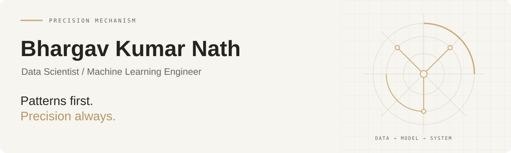

<picture>
  <source media="(prefers-color-scheme: dark)" srcset="./assets/header-dark.svg">
  <source media="(prefers-color-scheme: light)" srcset="./assets/header-light.svg">
  
</picture>

  <a href="https://precisionmechanism.dev/">Portfolio</a> ·
  <a href="https://precisionmechanism.dev/projects">Project case studies</a> ·
  <a href="https://www.linkedin.com/in/bhargavkumarnath/">LinkedIn</a> ·
  <a href="mailto:bhargavkumarnathh@gmail.com">Email</a>

I build data pipelines, predictive models, and the systems that run them. My work ranges from causal inference on millions of records to Rust memory allocators and CUDA kernels for LLM inference.

Based in **Leeds, UK** · **MSc Data Science & Analytics, University of Leeds (2024–2025)** · Open to ML engineering and applied research roles.

## Open source

**Merged into [apple/coreai-optimization](https://github.com/apple/coreai-optimization/pull/71)** · August 2026

Fixed a graph-mode quantization-aware training bug where a shared weight could use one module’s precision and another module’s training schedule. Aligned both with the same owner and added regression coverage.

## Selected work

<table>
<tr>
<td width="50%" valign="top">

### 01 / Custom CUDA Kernels

12 hand-written kernels for LLM, MoE, and RAG workloads, exposed to PyTorch through Rust and PyO3. Three kernels validated inside a real Llama-3-8B block.

`CUDA C++` `Rust` `PyTorch` `PyO3` `maturin`

[Source](https://github.com/BhargavKumarNath/custom_cuda_kernels) · [Engineering notes](https://precisionmechanism.dev/projects/custom-cuda-kernels)

</td>
<td width="50%" valign="top">

### 02 / PageForge

An on-demand paged KV-cache in Rust and CUDA. **8× less VRAM at 32 concurrent sequences, step 50**, with a measured +33% P50 latency cost against Hugging Face DynamicCache.

`Rust` `CUDA` `CuPy` `PyO3` `DLPack`

[Source](https://github.com/BhargavKumarNath/PageForge) · [Benchmarks & trade-offs](https://precisionmechanism.dev/projects/pageforge)

</td>
</tr>
<tr>
<td width="50%" valign="top">

### 03 / Criteo Uplift

A **13.98M-row randomized ad experiment**: estimate heterogeneous treatment effects, then use an X-Learner and a profit-aware bandit to decide who to target.

`Polars` `LightGBM` `scikit-learn` `FastAPI`

[Source](https://github.com/BhargavKumarNath/A-B-Testing) · [Case study](https://precisionmechanism.dev/projects/ab-testing-uplift)

</td>
<td width="50%" valign="top">

### 04 / Customer Intelligence

A **109.95M-event** behavioral pipeline built to run on a laptop. DuckDB and Polars power segmentation and propensity modelling, with explicit ordering to make repeated runs reproducible.

`DuckDB` `Polars` `LightGBM` `Pydantic`

[Source](https://github.com/BhargavKumarNath/Customer-Intelligence-Platform) · [Case study](https://precisionmechanism.dev/projects/customer-intelligence-platform)

</td>
</tr>
</table>

<strong>More projects — retrieval, quantization, forecasting & analytics</strong>

| Project | What I built | Tools |
| :--- | :--- | :--- |
| [FinSight-Alpha](https://precisionmechanism.dev/projects/finsight-alpha) | SEC filing retrieval with a bounded self-correction loop and budget-aware fallbacks. | LangGraph, Qdrant, BM25, Groq, RAGAS |
| [EMPAS](https://precisionmechanism.dev/projects/empas) | Evolutionary mixed-precision search, with proxy estimates checked against GPU measurements. | PyTorch, bitsandbytes, Hydra, NSGA-II |
| [PricePoint Dynamics](https://precisionmechanism.dev/projects/pricepoint-dynamics) | Forecasting and explainability over 9.5M UK supermarket price records. | DuckDB, Polars, LightGBM, SHAP, FAISS |
| [Andria Systems](https://precisionmechanism.dev/projects/andria-systems) | SEC 13F research pipeline with clustering, regime modelling, and an execution audit. | DuckDB, Polars, HDBSCAN, UMAP, hmmlearn |
| [Fitness Tracker Analysis](https://precisionmechanism.dev/projects/fitness-tracker-analysis) | Batch processing and held-out model evaluation on synthetic fitness data. | PySpark, PyArrow, scikit-learn, DuckDB-WASM |

## Tools I work with

  

| Area | Current project stack |
| :--- | :--- |
| GPU & systems | CUDA C++, Rust, PyO3, CuPy, DLPack, maturin |
| Modelling & evaluation | PyTorch, scikit-learn, LightGBM, SHAP, bitsandbytes, RAGAS |
| Data & validation | SQL, DuckDB, Polars, pandas, NumPy, PyArrow, Pydantic |
| Retrieval & agents | LangGraph, Qdrant, BM25, sentence-transformers, FAISS, Groq |
| Delivery & tooling | FastAPI, Next.js, React, Docker, pytest, Typer, Hydra |

## How I work

**Validate the input → establish a baseline → measure the trade-off → ship → audit.**

- Keep predicted improvements separate from measured results.
- Profile before fusing a kernel; keep the simpler version when it wins.
- Make data ordering, evaluation splits, and repeated runs reproducible.

[Read the engineering decision log →](https://precisionmechanism.dev/#about)

<strong>Background & writing</strong>

**Education:** MSc Data Science & Analytics, University of Leeds (2024–2025); BTech Computer Science & Engineering, Assam Don Bosco University (2020–2024).

**Experience:** Data analysis at M/S Sanjog Trading; data engineering internship at IIT Guwahati; data analyst internship at Airports Authority of India. [Full timeline →](https://precisionmechanism.dev/#experience)

Writing for **LeedsFINsights**:

- [ESG in the Age of AI: Why the Stakes Have Never Been Higher](https://www.leedsfinsights.com/post/esg-in-the-age-of-ai-why-the-stakes-have-never-been-higher)
- [Beyond the Hill: The Modern Algorithm’s Quest for Global Optima](https://www.leedsfinsights.com/post/beyond-the-hill-the-modern-algorithm-s-quest-for-global-optima)
- [The Evolution of Artificial Intelligence: From Symbolic AI to Deep Learning](https://www.leedsfinsights.com/post/the-evolution-of-artificial-intelligence-from-symbolic-ai-to-deep-learning)

## On GitHub

<picture>
  <source media="(prefers-color-scheme: dark)" srcset="https://raw.githubusercontent.com/BhargavKumarNath/BhargavKumarNath/output/github-contribution-grid-snake-dark.svg">
  <source media="(prefers-color-scheme: light)" srcset="https://raw.githubusercontent.com/BhargavKumarNath/BhargavKumarNath/output/github-contribution-grid-snake.svg">
  
</picture>

<strong>Activity & language metrics</strong>

Language metrics describe repository contents, not proficiency. Generated by the existing GitHub Actions workflows.

---

  Have a problem involving messy data, model evaluation, or inference performance? 
  <a href="mailto:bhargavkumarnathh@gmail.com">Let’s talk</a> · <a href="https://precisionmechanism.dev/">precisionmechanism.dev</a>

